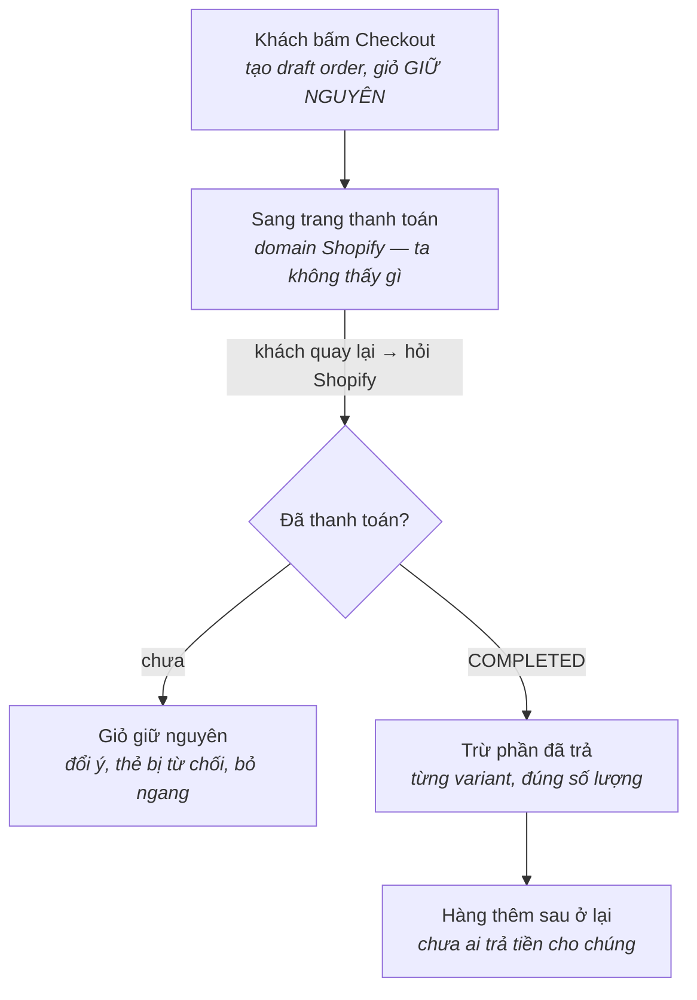

# Kịch bản test thủ công — Checkout B2Bridge

Nhánh `feat/b2bridge-b2b` · Dev store `maison-plus-2`

Tài liệu này dành cho người chưa theo dõi quá trình phát triển. Đọc từ trên
xuống và làm theo thứ tự là đủ.

## Bối cảnh

Cần kiểm một việc duy nhất: **sau khi khách bấm Checkout, giỏ hàng được dọn
đúng lúc và đúng phần**.

Storefront này không dùng checkout mặc định của Shopify cho khách sỉ. Khi bấm
Checkout, hệ thống gọi B2Bridge để tạo một **draft order** mang giá sỉ, rồi
chuyển khách sang trang thanh toán của Shopify.

Từ giây phút đó, storefront không biết gì nữa. Tiền đi qua domain của Shopify
và không có tín hiệu nào báo ngược về là khách đã trả hay bỏ ngang.

### Hai quy tắc đang được kiểm

**Một — không dọn giỏ ngay khi bấm Checkout.** Nếu dọn ngay, khách đổi ý hoặc
thẻ bị từ chối sẽ mất sạch giỏ. Với giỏ B2B vài chục dòng thì đó là thiệt hại
thật.

**Hai — khi đã trả tiền thì trừ đúng phần đã trả, không xoá sạch.** Giữa lúc
tạo hoá đơn và lúc quay lại, khách có thể đã thêm hàng mới. Những món đó chưa
ai trả tiền và phải ở lại.

Việc dọn xảy ra **khi khách quay lại storefront** — lúc đó hệ thống hỏi Shopify
xem draft order ấy đã chuyển sang `Completed` chưa, và chỉ hành động theo câu
trả lời đó.

### Ai làm được việc này

Không cần biết code. Cần: chạy được dev server trên máy, mở được DevTools của
trình duyệt, và có quyền vào Shopify admin của `maison-plus-2`.

Toàn bộ chín ca mất khoảng 40–55 phút.

## Luồng được kiểm



Cổng rẽ ở giữa là thứ các ca test xoay quanh. Hệ thống không đoán — nó hỏi
thẳng Shopify trạng thái draft order, và chỉ trừ hàng khi nhận được
`COMPLETED`.

Việc hỏi xảy ra khi **giỏ hàng được định giá**, tức khi mở giỏ hoặc vào trang
sản phẩm có bảng variant. Ở nguyên trang chủ mà không mở gì thì chưa chạy —
điều này quan trọng khi làm các ca bên dưới.

## Chuẩn bị

### 1. Lấy đúng nhánh

```bash
git checkout feat/b2bridge-b2b
npm install
```

Không phải `main` — `main` là bản Shopify B2B gốc, không có tính năng này.

### 2. Kiểm file `.env`

Cần ba dòng sau, không được thiếu dòng nào:

```
PUBLIC_STORE_DOMAIN=maison-plus-2.myshopify.com
HEADLESS_B2B_TOKEN=<khoá B2Bridge>
B2BRIDGE_DEV_CUSTOMER_ID=9196237291742
```

Dòng thứ ba quan trọng: nó làm storefront định giá như thể khách sỉ đó đang
đăng nhập, nên **không cần đăng nhập** trong suốt quá trình test. Thiếu nó thì
mọi giá sẽ là giá lẻ và không ca nào chạy đúng.

Cũng cần `WEAVERSE_HOST` và `WEAVERSE_API_KEY` — thường đã có sẵn. Chúng dùng
để hỏi Shopify trạng thái draft order.

### 3. Chạy dev server

```bash
npm run dev
```

Mở địa chỉ terminal in ra, thường là `http://localhost:3456`.

### 4. Mở sẵn hai tab

| Tab | Địa chỉ | Dùng để |
| --- | --- | --- |
| A | `localhost:3456` | Thêm hàng, bấm Checkout, xem giỏ |
| B | Shopify admin → **Orders → Drafts** | Đánh dấu hoá đơn đã trả tiền |

Tab B không phải mẹo test — nó thay cho việc khách trả tiền thật. Lý do giải
thích ở mục tiếp theo.

### 5. Tắt popup newsletter

Popup này làm Radix đặt `pointer-events: none` lên `body`, khiến ô nhập số
lượng **không nhận được focus**. Chạy một lần trong Console:

```js
localStorage.setItem("newsletter-popup-dismissed", "true")
```

### 6. Mở DevTools

F12 → tab **Network** → ô lọc gõ `b2b-`. Giữ mở suốt buổi test.

## Dữ liệu tham chiếu

Trong cả chín ca chỉ dùng hai sản phẩm dưới đây. Các sản phẩm khác không nằm
trong bảng giá sỉ và sẽ không cho kết quả như mô tả.

| Tên hiển trên web | Variant id | Giá lẻ | Tối thiểu |
| --- | --- | --- | --- |
| **Bold Stripe Linen Duvet** — Queen / White Stripe | `47591719436510` | $325 | 5 |
| **Bold Stripe Linen Duvet** — King / White Stripe | `47591720878302` | $390 | 5 |
| **Corded-Stripe Linen Duvet Cover** — King / Natural Beige | `47591722352862` | $325 | 5 |

Thêm nhanh vào giỏ bằng cách mở thẳng địa chỉ này, mỗi lần thêm 1 cái:

```
http://localhost:3456/cart/add/47591719436510
```

### Giá sỉ theo số lượng

Giá thay đổi theo **tổng số lượng của cả sản phẩm**, cộng mọi variant:

| Tổng số lượng | Giảm | Queen thành |
| --- | --- | --- |
| 1–9 | 0% | $325 |
| 10–19 | tới 20% | $260 ở đúng mốc 10 |
| 20+ | tới 30% | $227.50 ở đúng mốc 20 |

Ở các số lượng không trùng mốc, giá nằm giữa hai mức và trông "lẻ" — ví dụ 11
cái ra $265.91. **Đó không phải lỗi** của phần đang test; xem mục cuối.

### Hai điều kiện dễ bị quên

**Số lượng tối thiểu là 5.** Dưới 5, nút Checkout bị khoá và không bấm được.
Mọi ca dưới đây dùng 10 trở lên cho chắc.

**Phải ở thị trường Canada.** Đó là mặc định khi mở `localhost:3456`. Nếu địa
chỉ có `/vi-vn` thì đang ở thị trường Việt Nam, nơi bảng giá sỉ không áp dụng —
bỏ `/vi-vn` khỏi địa chỉ.

## Cách quan sát và cách giả lập thanh toán

### Ba request cần nhìn trong Network

Với ô lọc `b2b-`, sẽ thấy ba loại:

| Tên | Khi nào chạy | Ý nghĩa |
| --- | --- | --- |
| `b2b-cart-pricing` | Mỗi lần giỏ đổi hoặc mở giỏ | Lấy giá sỉ |
| `b2b-checkout` | Khi bấm nút Checkout | Tạo hoá đơn |
| `b2b-settle` | Khi quay lại, nếu đang có hoá đơn chờ | Hỏi Shopify và dọn giỏ |

Bấm vào một request → tab **Response** để đọc kết quả. `b2b-settle` trả về đúng
một trong hai:

```json
{"settled": false}   ← chưa trả tiền, giỏ không đổi
{"settled": true}    ← đã trả, giỏ vừa bị trừ
```

### Thấy gì sau khi bấm Checkout

Trình duyệt sẽ nhảy sang một trang của Shopify **hỏi mật khẩu cửa hàng**. Đó là
bình thường — dev store đang ở chế độ bảo vệ bằng mật khẩu, nên không vào được
trang thanh toán thật.

**Không cần làm gì ở trang đó.** Bấm Back để quay về storefront.

### Giả lập "khách đã trả tiền"

Vì không vào được trang thanh toán, dùng Shopify admin thay thế. Kết quả cuối
giống hệt nhau: draft order chuyển từ `Open` sang `Completed`, mà hệ thống chỉ
hỏi đúng điều đó.

Trong **tab B**:

1. **Orders → Drafts**
2. Mở draft **mới nhất** — số `#D` lớn nhất, tạo cách đây vài giây
3. **Collect payment → Mark as paid**
4. Trạng thái chuyển sang **Completed**

> ⚠️ Chọn đúng draft vừa tạo. Trong danh sách còn vài draft cũ từ các lần thử
> trước; đánh dấu nhầm cái cũ thì ca test sẽ không ra kết quả như mô tả.

### Sau đó phải làm gì để hệ thống biết

Quay về **tab A**, **tải lại trang**, rồi **mở giỏ hàng**.

Việc dọn chỉ chạy khi giỏ được định giá — tức khi mở giỏ hoặc vào trang sản
phẩm có bảng variant. Ngồi ở trang chủ mà không mở gì thì sẽ không thấy
`b2b-settle` chạy, và đó không phải lỗi.

## Các ca test

Làm theo thứ tự. Mỗi ca bắt đầu bằng **giỏ rỗng** trừ khi ghi rõ khác — dọn giỏ
bằng nút **Remove All** ở trang `/cart`.

### Ca 1 — Bấm Checkout, giỏ không bị dọn

*Đây là ca quan trọng nhất. Trước khi sửa, giỏ bị xoá sạch ở bước này.*

1. Thêm **Queen** số lượng **10** vào giỏ
2. Mở giỏ, kiểm giá hiển **$260/cái**, tổng **$2,600**
3. Bấm **Checkout**
4. Trình duyệt sang trang hỏi mật khẩu — bấm **Back**
5. Mở lại giỏ hàng

**Phải thấy:** giỏ vẫn có **Queen 10**, nguyên vẹn. Trong Network có
`b2b-settle` trả `{"settled": false}`. Trong admin xuất hiện một draft mới
trạng thái **Open**.

### Ca 2 — Đổi ý, không trả tiền

*Tiếp ngay sau ca 1, không dọn giỏ.*

1. Tải lại trang 2–3 lần
2. Mở và đóng giỏ vài lần
3. Đổi số lượng Queen thành 12 rồi về 10

**Phải thấy:** giỏ không bao giờ bị dọn. Mọi `b2b-settle` đều
`{"settled": false}`. Khách vẫn mua tiếp và sửa giỏ bình thường.

### Ca 3 — Trả tiền xong, chỉ dọn phần đã trả

*Ca trọng tâm. Bắt đầu từ giỏ rỗng.*

1. Thêm **Queen** số lượng **10**
2. Bấm **Checkout**, rồi bấm **Back**
3. Thêm **King / White Stripe** số lượng **2**
4. Giỏ lúc này: Queen 10 · King 2 — xác nhận bằng mắt
5. **Tab B**: mở draft mới nhất → **Mark as paid** → trạng thái **Completed**
6. **Tab A**: tải lại trang, mở giỏ

**Phải thấy:**

- `b2b-settle` trả `{"settled": true}`
- Giỏ **chỉ còn King 2**
- Queen 10 đã biến mất — đã trả tiền
- King 2 còn nguyên — thêm sau hoá đơn, chưa ai trả

### Ca 4 — Mua thêm chính món đã mua

*Giỏ rỗng trước khi bắt đầu.*

1. Thêm **Queen** số lượng **10**
2. **Checkout**, rồi **Back**
3. Tăng Queen lên **14** (thêm 4 cái nữa)
4. **Tab B**: draft mới nhất → **Mark as paid**
5. **Tab A**: tải lại, mở giỏ

**Phải thấy:** giỏ còn **Queen 4**. Không phải 0, cũng không phải 14. Hệ thống
trừ số lượng chứ không xoá cả dòng.

### Ca 5 — Không dọn lặp lại

*Tiếp ngay sau ca 4, không dọn giỏ.*

1. Tải lại trang 3 lần, mỗi lần mở giỏ

**Phải thấy:** giỏ giữ nguyên **Queen 4** qua cả ba lần. Không có
`{"settled": true}` lần thứ hai.

### Ca 6 — Hai sản phẩm khác nhau

*Giỏ rỗng trước khi bắt đầu.*

1. Thêm **Queen** 10 **và** **Corded-Stripe King** 5
2. **Checkout**, rồi **Back**
3. Thêm **King / White Stripe** số lượng **2**
4. **Tab B**: draft mới nhất → **Mark as paid**
5. **Tab A**: tải lại, mở giỏ

**Phải thấy:** giỏ chỉ còn **King 2**. Cả hai dòng trong hoá đơn đều bị trừ, dù
thuộc hai sản phẩm khác nhau.

### Ca 7 — Bấm Checkout hai lần

*Giỏ rỗng trước khi bắt đầu. Làm nhanh, trong vòng 60 giây.*

1. Thêm **Queen** 10
2. Bấm **Checkout** → **Back**
3. Bấm **Checkout** lần nữa ngay

**Phải thấy:** trong Network, hai request `b2b-checkout` trả về `invoiceUrl`
**giống hệt nhau**. Trong admin **chỉ có một** draft mới, không phải hai.

Sau 60 giây thì bấm lại sẽ tạo hoá đơn mới — đó là đúng, không phải lỗi.

### Ca 8 — Giỏ còn ít hơn số lượng đã trả

*Giỏ rỗng trước khi bắt đầu.*

1. Thêm **Queen** số lượng **10**
2. **Checkout**, rồi **Back**
3. Giảm Queen trong giỏ xuống **3** — nút Checkout khoá lại vì dưới mức tối
   thiểu 5, đó là đúng
4. **Tab B**: draft mới nhất → **Mark as paid**
5. **Tab A**: tải lại, mở giỏ

**Phải thấy:** `b2b-settle` trả `{"settled": true}` và giỏ **rỗng**.

Hệ thống chỉ trừ được 3 món đang có; 7 món chênh lệch bị bỏ qua chứ không tạo
ra số lượng âm. Lưu ý việc dọn vẫn chạy dù giỏ đang dưới mức tối thiểu — nó
chỉ cần biết có hoá đơn đang chờ, không quan tâm giỏ có checkout được hay
không.

### Ca 9 — Draft bị xoá

*Giỏ rỗng trước khi bắt đầu. Khác với ca 2: ở đó draft vẫn còn và đang `Open`.*

1. Thêm **Queen** số lượng **10**
2. **Checkout**, rồi **Back**
3. **Tab B**: ghi lại số `#D` của draft mới nhất, rồi **Delete draft order** —
   xoá hẳn, **không** đánh dấu đã trả
4. **Tab A**: tải lại, mở giỏ
5. Tải lại và mở giỏ **thêm một lần nữa**

**Phải thấy:**

- Lần đầu: `b2b-settle` trả `{"settled": false}`, giỏ vẫn có **Queen 10**
- Terminal có dòng `[B2Bridge] draft order no longer exists: ...`
- Lần thứ hai: **không còn gọi `b2b-settle`** nữa

Shopify trả `{"draftOrder": null}` cho một draft đã xoá — đó là câu trả lời
dứt khoát, không phải lỗi đọc. Nên hệ thống bỏ ghi chú chờ ngay thay vì hỏi
lại suốt 24 giờ. Giỏ giữ nguyên vì chưa ai trả tiền cho nó.

> Chỉ xoá đúng draft vừa tạo trong bước 2. Xoá nhầm draft của ca khác sẽ làm
> hỏng kết quả ca đó.

## Ghi kết quả

Điền trực tiếp vào bảng này. Cột cuối chỉ cần điền khi không đạt.

| Ca | Nội dung | Đạt | Thực tế thấy gì |
| --- | --- | --- | --- |
| 1 | Bấm Checkout, giỏ không bị dọn | | |
| 2 | Đổi ý, không trả tiền | | |
| 3 | Trả tiền xong, chỉ dọn phần đã trả | | |
| 4 | Mua thêm chính món đã mua | | |
| 5 | Không dọn lặp lại | | |
| 6 | Hai sản phẩm khác nhau | | |
| 7 | Bấm Checkout hai lần | | |
| 8 | Giỏ còn ít hơn số lượng đã trả | | |
| 9 | Draft bị xoá | | |

### Khi một ca không đạt

Chụp hoặc ghi lại bốn thứ sau, càng đủ càng dễ tìm nguyên nhân:

1. **Nội dung giỏ** — tên variant và số lượng từng dòng
2. **Response của `b2b-settle`** trong tab Network
3. **Số `#D` và trạng thái** của draft order trong admin
4. **Terminal đang chạy `npm run dev`** — tìm dòng bắt đầu bằng `[B2Bridge]`

Thứ tư thường là câu trả lời. Những dòng đó ghi thẳng lý do, ví dụ:

```
[B2Bridge] draft order lookup failed: ...
[B2Bridge] cart not settled: ...
[B2Bridge] /api/v1/headless/checkout 429 ...
```

### Một lưu ý về giới hạn số lần gọi

B2Bridge chỉ cho **20 lần gọi mỗi phút cho cả cửa hàng**. Làm test liên tục,
đặc biệt khi bấm tăng giảm số lượng nhiều, có thể chạm trần.

Dấu hiệu: nút Checkout mờ đi kèm dòng *"Wholesale pricing is unavailable right
now"*, và terminal có dòng `429`.

Đó **không phải lỗi của phần đang test**. Chờ khoảng một phút rồi làm tiếp — hệ
thống tự thử lại. Ghi chú lại nếu gặp, vì số lần gặp cũng là thông tin hữu ích.

## Đã biết trước — không phải lỗi

Những thứ dưới đây sẽ gặp trong lúc test. Không cần báo lại.

**Trang hỏi mật khẩu sau khi bấm Checkout.** Dev store đang bật bảo vệ bằng mật
khẩu. Vì vậy mới phải dùng admin để đánh dấu đã trả tiền.

**Trong admin có sẵn vài draft order cũ.** Từ các lần thử trước. Luôn chọn
draft có số `#D` lớn nhất.

**Mỗi lần bấm Checkout sinh ra một draft order không xoá được.** B2Bridge không
có chức năng xoá. Sau buổi test sẽ còn lại khoảng 5–7 draft; chúng đều có tag
`B2Bridge Headless` nên lọc và dọn thủ công được.

**Giá ở số lượng lẻ trông kỳ lạ.** Mua 11 cái ra $265.91, mua 19 cái đắt hơn
mua 20 cái. Đây là cách B2Bridge tính bậc giá, đã được ghi nhận và đang chờ họ
trả lời. Không liên quan đến phần đang test.

**Dọn giỏ chỉ hoạt động trong cùng một phiên browser.** Đây là giới hạn lớn
nhất trong danh sách này, nên đọc kỹ.

Ghi chú chờ — thứ cho storefront biết "có một hoá đơn đang đợi trả tiền" — nằm
trong cookie phiên, và cookie đó không có `maxAge`:

```ts
// app/.server/context.ts
createCookieSessionStorage({
  cookie: { name: "session", httpOnly: true, path: "/", sameSite: "lax", secrets },
})
```

Không có `maxAge` nghĩa là cookie chết khi khách đóng browser. Ghi chú chờ mất
theo, nên storefront không còn biết phải hỏi Shopify về đơn nào. Khách trả tiền
sau khi đã đóng browser thì **giỏ không bao giờ được dọn**, và họ có thể mua lại
chính món đã trả.

Khoảng cách này là thật, không phải trường hợp hiếm: link `invoiceUrl` của
Shopify sống tới một năm (draft order tự xoá sau một năm không chỉnh sửa, và
mỗi lần sửa thì tính lại), nên khách hoàn toàn có thể nhận hoá đơn hôm nay và
trả tiền tuần sau, từ một máy khác. Cả 9 ca test ở trên đều làm trong một phiên
nên không ca nào chạm tới chuyện này.

Hệ quả thứ hai: mốc 24 giờ trong code gần như không bao giờ tới, vì cookie mất
trước. Nó là lưới an toàn cho ghi chú không bao giờ được giải quyết, không phải
thời hạn thực tế để khách trả tiền.

Hướng xử lý đã xác định nhưng chưa làm, và là một task riêng: bỏ ghi chú trong
session, thay bằng hỏi Shopify mỗi phiên một lần xem customer này có draft
order `COMPLETED` nào mà hàng còn trong giỏ. Query đã kiểm là chạy được:

```
draftOrders(query: "customer_id:<id> status:completed")
```

Nó cần thêm một dấu bền vững để biết đơn nào đã dọn rồi, nếu không sẽ dọn lặp
lại và vi phạm Ca 5; chỗ hợp lý là một tag trên chính draft order.

**Ô xám nhấp nháy khi đổi số lượng.** Đó là lúc đang hỏi lại giá. Mất khoảng
1–2 giây.

**Mọi variant cùng một sản phẩm đều nhấp nháy cùng lúc.** Đúng như thiết kế:
bậc giá tính trên tổng số lượng của cả sản phẩm, nên đổi một variant làm đổi
giá của cả nhóm.

### Hai ca không test tay được

**Hoá đơn quá 24 giờ.** Phải chờ đúng một ngày. Hành vi đúng là: bỏ ghi chú
chờ, giỏ giữ nguyên. Trong thực tế cookie phiên thường mất trước khi tới mốc
này — xem mục về phiên browser ở trên.

**Mạng hỏng đúng lúc hỏi Shopify.** Hành vi đúng là: **không** dọn giỏ, giữ ghi
chú để thử lại lần sau. Chủ ý: đọc không được không có nghĩa là chưa trả tiền.
